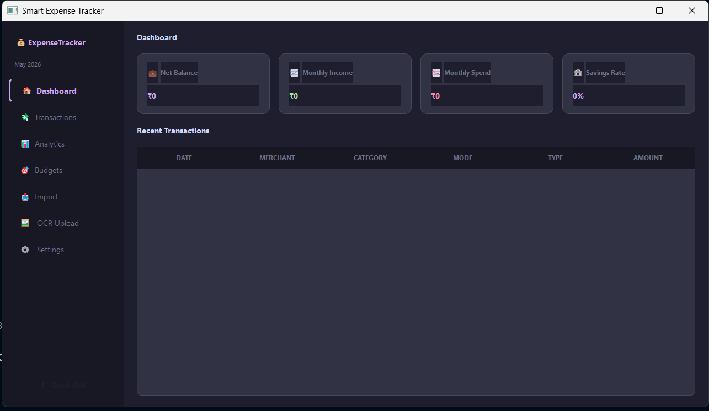
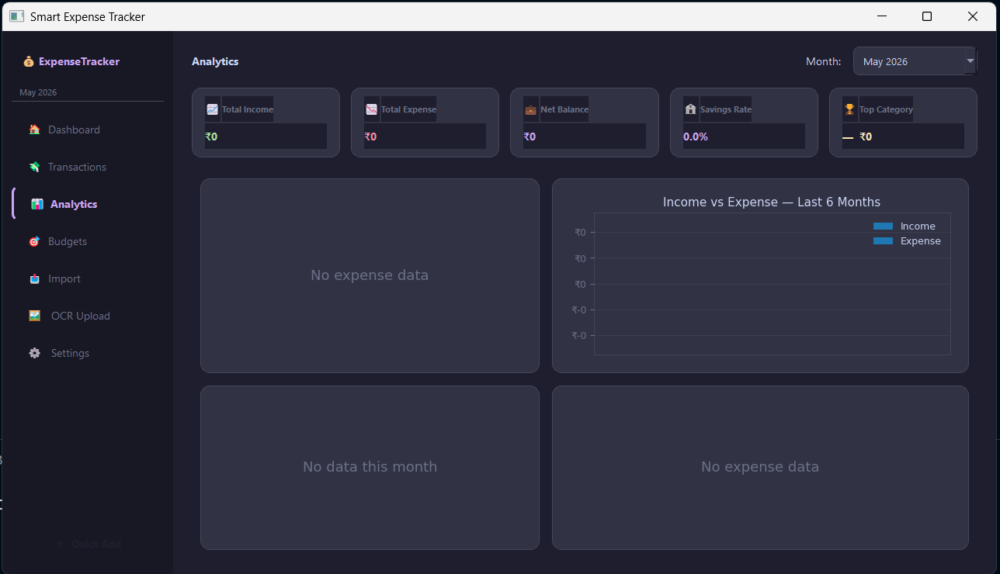
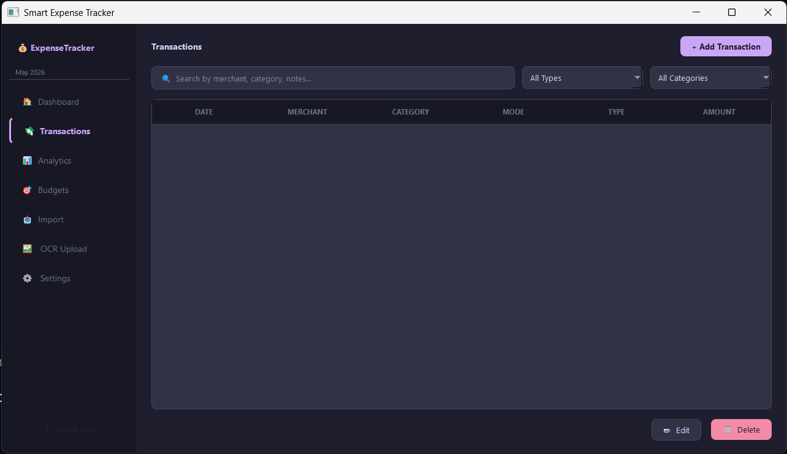
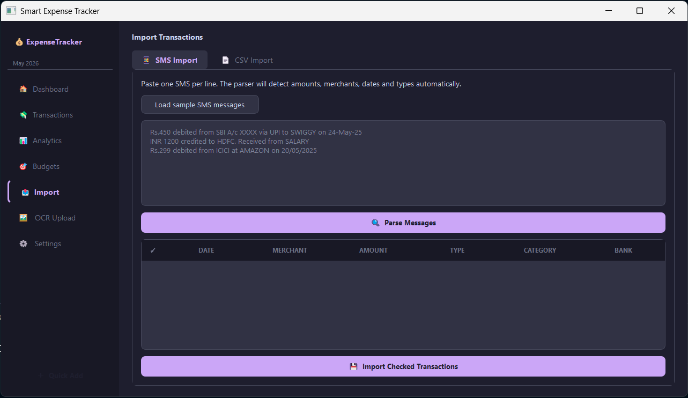
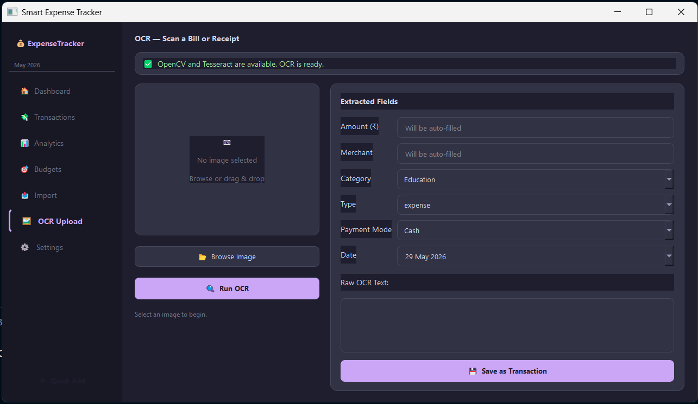
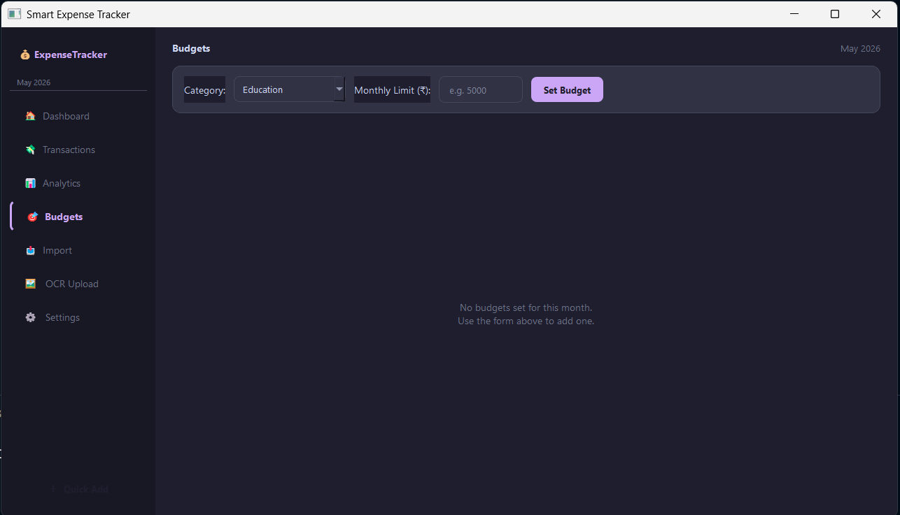

# 💰 Smart Expense Tracker

A modern, fully-featured personal finance desktop application built with **Python + PyQt5**.
Dark-themed, analytics-rich, and resume-worthy.

---

## ✨ Features

| Module                  | What it does                                                                           |
| ----------------------- | -------------------------------------------------------------------------------------- |
| 🏠 **Dashboard**        | Summary cards (balance, income, expense, savings rate) + recent transactions           |
| 💸 **Transactions**     | Add / edit / delete / search / filter by type, category, date                          |
| 📊 **Analytics**        | 4 embedded matplotlib charts: pie, grouped bar, cumulative daily line, top merchants   |
| 🎯 **Budgets**          | Set monthly limits per category; progress bars; over-budget alerts                     |
| 📥 **Import**           | Bulk SMS paste parser + CSV bank statement importer with column mapping                |
| 🖼 **OCR**              | Upload bill/receipt image → OpenCV pre-process → Tesseract OCR → auto-fill transaction |
| ⚙ **Settings & Export** | Export CSV or PDF report per month; manage custom categories                           |

---

## 📸 Screenshots

| Dashboard                         | Analytics                        |
| --------------------------------- | -------------------------------- |
|  |  |

| Transactions                        | Import Feature                |
| ----------------------------------- | ----------------------------- |
|  |  |

| OCR Upload                        | Budgeting                      |
| --------------------------------- | ------------------------------ |
|  |  |

| Settings and Export                        |
| ------------------------------------------ |
|  |

---

## 🛠 Tech Stack

| Layer            | Library                                     |
| ---------------- | ------------------------------------------- |
| GUI              | PyQt5                                       |
| Database         | SQLite (built-in)                           |
| Charts           | Matplotlib (embedded via FigureCanvasQTAgg) |
| PDF Export       | ReportLab                                   |
| Statement Import | pandas, pdfplumber                          |
| OCR              | OpenCV, pytesseract                         |
| Categorization   | Rule-based keyword mapping (60+ rules)      |
| SMS Parsing      | Python `re` (regex)                         |

---

## 📁 Project Structure

```
expense_tracker/
│
├── main.py                  ← App entry point, all pages wired
├── database.py              ← DatabaseManager (singleton, all CRUD + analytics)
├── requirements.txt
│
├── models/
│   └── transaction.py       ← Transaction + Budget dataclasses
│
├── ui/
│   ├── analytics_page.py    ← 4 matplotlib charts + stat cards
│   ├── budgets_page.py      ← Budget progress cards + alert banner
│   ├── import_page.py       ← SMS bulk import + CSV statement import
│   ├── ocr_page.py          ← Image upload → OCR → transaction
│   └── settings_page.py     ← Export CSV/PDF + category manager
│
├── analytics/
│   └── charts.py            ← CategoryPie, MonthlyTrend, DailySpend, TopMerchants
│
├── parsers/
│   ├── sms_parser.py        ← Regex SMS parser (Indian bank formats)
│   ├── statement_parser.py  ← CSV + PDF bank statement parser
│   └── ocr_processor.py     ← OpenCV pre-process + Tesseract OCR pipeline
│
├── exports/
│   └── report_exporter.py   ← CSV export + ReportLab PDF report
│
└── utils/
    └── categorizer.py       ← 60+ keyword → category mappings
```

---

## 🚀 Installation

### 1. Clone / unzip the project

```bash
cd expense_tracker
```

### 2. Create a virtual environment (recommended)

```bash
python -m venv venv
# Windows:
venv\Scripts\activate
# macOS/Linux:
source venv/bin/activate
```

### 3. Install Python dependencies

```bash
pip install -r requirements.txt
```

### 4. Install Tesseract binary (for OCR only)

**Ubuntu/Debian:**

```bash
sudo apt install tesseract-ocr
```

**Windows:**
Download from https://github.com/UB-Mannheim/tesseract/wiki and add to PATH.

**macOS:**

```bash
brew install tesseract
```

> OCR is optional. All other features work without Tesseract.

### 5. Run

```bash
python main.py
```

---

## 📊 Database Schema

```sql
users        (id, username, password_hash, created_at)
transactions (id, user_id, amount, category, merchant, type,
              payment_mode, notes, transaction_date, created_at)
categories   (id, name)
budgets      (id, category, limit_amount, month)
```

The SQLite file `expense_tracker.db` is created automatically on first run.

---

## 📱 SMS Parser — Supported Formats

The SMS parser handles common Indian bank notification formats:

```
Rs.450 debited from SBI A/c XXXX via UPI to SWIGGY on 24-May-25
INR 50000 credited to HDFC. Received from SALARY
Your ICICI A/c XX1234 is debited with Rs.299 at AMAZON on 20/05/2025
Rs 85 spent at UBER via AXIS debit card
```

Supported banks: SBI, HDFC, ICICI, AXIS, KOTAK, PNB, BOB, CANARA, UNION, YES BANK, IDBI

---

## 🏷 Auto-Categorization

60+ keyword rules in `utils/categorizer.py`:

| Merchant keyword           | Category      |
| -------------------------- | ------------- |
| Swiggy, Zomato, Dominos    | Food          |
| Uber, Ola, IRCTC, IndiGo   | Transport     |
| Amazon, Flipkart, Myntra   | Shopping      |
| Netflix, Hotstar, Spotify  | Entertainment |
| Apollo, Pharmacy, Hospital | Health        |
| Airtel, Jio, Electricity   | Utilities     |
| Salary, Payroll            | Salary        |
| Zerodha, Groww, Dividend   | Investment    |

---

## 📦 Build Executable (optional)

```bash
pip install pyinstaller
pyinstaller --onefile --windowed --name ExpenseTracker main.py
# Output: dist/ExpenseTracker.exe  (Windows)
#         dist/ExpenseTracker      (Linux/macOS)
```

---

## 🔮 Future Enhancements

- [ ] Login / multi-user authentication
- [ ] AI-based expense prediction (scikit-learn)
- [ ] Email reports (smtplib)
- [ ] Cloud sync (Firebase / Supabase)
- [ ] Mobile companion app
- [ ] Voice input (SpeechRecognition)
- [ ] REST API backend (FastAPI)
- [ ] Recurring transactions
- [ ] Bill reminders

---

## 🧩 OOP Design Highlights

- **`DatabaseManager`** — Singleton pattern; single connection across the whole app
- **`Transaction`** — Dataclass with validation, `from_db_row()` factory, computed properties
- **`Budget`** — Dataclass with display helpers
- **`BaseChart`** — Abstract base for all matplotlib chart widgets
- **`OCRWorker`** — `QThread` subclass; OCR runs off the main thread (no UI freeze)
- **`NavButton`** — Custom `QPushButton` with active-state styling

---

## 👨‍💻 Skills Demonstrated

This project covers:
`GUI development` · `SQLite ORM-style patterns` · `Regex parsing` · `Data visualization` ·
`File handling` · `OCR pipeline` · `PDF generation` · `Multithreading` · `OOP architecture` ·
`Dark theme UI` · `Modular Python packaging`

---

## AUTHOR
### MAYANK KUMAR
B. Tech. CSE
Lovely Professional University
